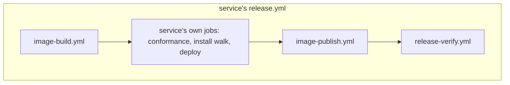

# Shared building blocks for the core services' workflows

## Overview

The per-push gate and the Kubernetes service release already live in ci. The
release of a signed image does not, so ten core services each wrote one: build
the images by digest, sign them, write and attest their bills of materials, tag
them, attach signed checksums. Beside the shared gate, the same services also
repeat the same static checks on every push. Every copy carries its own action
pins, so one upstream release means a bump in up to thirteen repositories.

This spec adds two reusable stages to ci, a build stage and a publish stage,
that a service calls with its own jobs in between, plus a reusable workflow
that verifies a published release. The stages are built from composite
actions, which `service-release.yml` also uses inside its one job, so signing
has one copy in ci. The repeated static checks move into `lateregate`. Each
service keeps its own conformance tests, install walk and deploy between the
two stages.

## Current State

The thirteen core services and how they release today:

| Service | Visibility | Release | release.yml lines | Pinned actions |
| --- | --- | --- | --- | --- |
| platform, auth, insula | private | `service-release.yml` | 57 to 212 | 15, 13, 21 |
| topos, lectio, pons | public | own build, then `notes-release.yml` | 212 to 317 | 17, 22, 16 |
| sermo, examen, limen | private | own build, then `notes-release.yml` | 243 to 343 | 16, 17, 14 |
| lux, cella, arca, origo | public | entirely their own | 586 to 885 | 43, 38, 37, 68 |

The ten services outside `service-release.yml` repeat these steps, with small
differences (`pons/.github/workflows/release.yml` is the shortest whole
example):

- **Wait for the tagged commit's checks** (8: cella, lux, topos, lectio, pons,
  sermo, examen, limen). Three variants of the same `gh api` loop: wait up to
  an hour (public, hosted runner); refuse at once when the run is still going,
  so the job does not hold a slot on the self-hosted runner (examen, limen);
  walk back past commits that change only specs and Markdown, which the verify
  path filter skips (examen).
- **Preflight** (10): the image namespace from the repository owner, lowered,
  with a repository variable as override; the tag has a CHANGELOG section
  (`go tool lateregate release-notes`); the tag carries no build metadata; the
  build identity (short commit, commit date).
- **Image by digest** (10): `docker buildx build` for linux/amd64 and
  linux/arm64, `push-by-digest=true`, under no tag; then the candidate reports
  the version the tag pins. One to three images per service.
- **Sign and attest** (10): `cosign sign` by digest, an SPDX bill of materials
  with `anchore/sbom-action`, and `actions/attest-sbom` plus
  `actions/attest-build-provenance` when the repository is public.
- **Tag the digests** (10): `docker buildx imagetools create`.
- **Signed checksums** (8): `checksums.txt` over the attached files and a
  `cosign sign-blob` bundle.
- **Create the release** (4 create it themselves: cella, lux, arca, origo; 6
  call `notes-release.yml` and attach files after it in a separate job).
- **Verify the published release** from a clean runner (3: cella, lux, origo;
  arca's spec 016 plans it).

On every push, beside `lateregate.yml`:

| Check | Services |
| --- | --- |
| `go mod tidy -diff` | cella, lux, topos, arca, lectio, pons, sermo, examen, limen, origo |
| build the image, report the version, size cap, no shell, start read-only | the same ten, and platform builds only |
| actionlint | platform, insula, examen, limen |
| render the Kubernetes manifests | cella, lectio, origo, arca (on release) |
| `promtool check rules` | lux, arca, origo |
| frontend install, typecheck, test, build | auth, platform, insula |

`ci-gate` runs none of these today.

Signing identity today: the ten services sign as their own `release.yml`, and
four publish a verify command that matches it exactly (`lux/SECURITY.md`,
`cella/docs/install.md`, `arca/docs/operations.md`,
`origo/docs/upgrades/README.md`). `service-release.yml` signs as ci's
workflow, and its README section "Signatures and SBOMs" documents the command
for that: the identity matches
`^https://github\.com/latere-ai/ci/\.github/workflows/service-release\.yml@`
and `--certificate-github-workflow-repository` names the caller.

## Design

### Where each piece lives

- **Reusable stages in ci** are what a service calls: `image-build.yml`,
  `image-publish.yml` and `release-verify.yml`. A service writes a few lines
  per stage and its own jobs between them.
- **Composite actions in ci** (`ci/actions/<name>/`) are the blocks the stages
  are built from. `service-release.yml` uses the same blocks inside its one
  job. A service whose shape the stages do not fit composes its own job from
  the blocks; it then signs as its own workflow and documents that.
- **Gates in `lateregate`** hold every static check, so it runs on a laptop
  exactly as in CI, is picked up by pinning a ci-gate version, and is waived
  in `.lateregate.yaml` with a reason.

### Signing identity

A signature made in a reusable stage names the stage's file in ci, as
`service-release.yml` does today. Any repository can call a public workflow,
so the identity names the pipeline and not the source; the verify command
binds the source with the repository check. One command shape then holds for
every Latere image:

- `cosign verify` with `--certificate-identity-regexp` matching
  `^https://github\.com/latere-ai/ci/\.github/workflows/image-build\.yml@`
  and `--certificate-github-workflow-repository latere-ai/<service>`.
- `cosign verify-blob` for `checksums.txt` with the publish stage's file and
  the same repository check.
- `gh attestation verify oci://<image>@<digest> -R latere-ai/<service>` with
  `--signer-workflow` naming the build stage.

The four published verify commands move to this shape, and keep the old
command for releases cut before the switch. The `gh attestation verify` form
for a reusable-workflow signer is confirmed on the first prerelease run before
it goes into the public docs; the `service-release.yml` callers are private,
so it has not run against a public caller yet.

### A release, composed

A service with nothing between build and publish (topos, pons, sermo, limen,
examen, lectio) calls the three stages in a row. lux, cella, arca and origo
keep their conformance, deploy and install jobs where they are today, reading
the digests the build stage outputs.

### `image-build.yml`

One job, so a release on the self-hosted runner queues for it once. Steps:

1. **`verified-commit`**: the tagged commit's verify run concluded success.
   Inputs `verify_workflow` (default `verify.yml`), `wait_minutes` (default 60;
   0 refuses at once while the run is going, for the self-hosted runner),
   `skip_paths` (default `specs/**` and `*.md`: a commit that changes only
   these carries its parent's code, so its parent is read where its own
   run is missing, still going or cancelled).
2. **`release-preflight`**: namespace (override `vars.RELEASE_IMAGE_NAMESPACE`),
   CHANGELOG section, no build metadata, build identity.
3. **Archives**, when `archives_command` is set: the service's own script
   (`tools/release/build.sh "$TAG" dist`, `make release-archives`) writes into
   `dist/`.
4. **Per image**: `image-by-digest` (build and push under no tag, the version
   report), then `sign-image` (`cosign sign`, the SPDX bill into `dist/`, the
   two attestations when the repository is public).
5. `dist/` uploaded as an artifact for the publish stage.

Images are three fixed slots, `image_1` to `image_3`, each a JSON object
(`name`, `dockerfile`, `context`, `platforms`, `version_args`), and the
outputs are `owner` and `digest_1` to `digest_3`. The attestation actions take
one image per step and a job cannot loop over steps, so each slot is its own
set of steps, skipped when empty. A matrix job per image was considered: it
costs a queue wait per image on the self-hosted runner and a matrix job cannot
output one value per leg. Three slots cover every service today (cella's
third is a stubs image for one platform); a fourth service image means a
fourth slot in ci.

### `image-publish.yml`

Steps: `tag-images` (the digests get the release tag), `signed-checksums`
(over `dist/` and any artifacts the caller names, such as a conformance
fixture), `publish-release` (a draft with the tag's CHANGELOG section as its
body and evidence files the caller names appended, the files attached, then
published and marked latest). `notes-release.yml` calls `publish-release` too,
so one step creates every release.

### `release-verify.yml`

From a clean runner with no checkout: downloads every asset, verifies
`checksums.txt` and each image in the command shape above, proves an identity
from another repository is refused, optionally checks an image carries the
archive's binary, and checks the body equals the CHANGELOG section.

### Composite actions

`verified-commit`, `release-preflight`, `image-by-digest`, `sign-image`,
`tag-images`, `signed-checksums`, `publish-release`, `verify-release` (the
body of `release-verify.yml`) and `ensure-gh`. Each keeps its decisions
in a script beside its `action.yml` (`ci/actions/<name>/run.sh`), so the tests
run the shipped file rather than a copy. Every third-party action inside is
pinned by commit, and every tool version (cosign, syft, gh) is an input whose
default is defined once in ci and shared with `service-release.yml`.

`service-release.yml` stays one job, as decided at v1.25.0, and replaces its
own signing steps with `sign-image`.

### Gates in `lateregate`

Each is a gate in ci-gate, applies when its input exists, and is configured in
`.lateregate.yaml` only where a service differs:

- **`tidy`**: `go mod tidy -diff`.
- **`actionlint`**: over `.github/workflows`, at a version ci-gate pins.
- **`manifests`**: every directory with a `kustomization.yaml` renders.
- **`rules`**: every PrometheusRule document passes `promtool check rules`,
  promtool at a pinned version verified against its checksum. This takes the
  `prometheus/prometheus` download out of origo's workflow.
- **`image`**: per image, it builds, reports its version, stays under a size
  cap, holds no shell, and starts with a read-only root file system and
  answers a probe. Configured per image: name, Dockerfile, version arguments,
  `max_mib`, start arguments and environment, probe path and port. A start
  that needs a database first (examen) stays the service's own job. Docker
  runs it on a hosted runner and podman on the self-hosted one, whichever is
  on `PATH`.
- **`frontend`**: install with the frozen lockfile, then whichever of
  `typecheck`, `test` and `build` the package defines.

### Rework of ci's existing pipelines

The same blocks take the repeated parts out of ci's own workflows:

- **Go setup.** 21 `actions/setup-go` steps in ci's workflows carried 29
  copies of the expression that tells a hosted runner from the self-hosted
  one (`startsWith(..., 'ubuntu-') || startsWith(..., 'macos-') || ...`)
  to choose the module cache. Every step-level choice now reads
  `runner.environment == 'github-hosted'`. No `setup-go` action wraps it:
  the gate jobs would need ci's checkout beside the caller's to reach one,
  and the gates scan the checkout. The label expression stays where no
  runner exists yet (job `if:`, job `env`, the plan in `lateregate.yml`).
- **gh on the self-hosted runner.** `notes-release.yml` and
  `service-release.yml` carried the same 15-line "Ensure gh" step, and
  examen and limen copy it. It is the `ensure-gh` action, used by
  `verified-commit`, `publish-release` and `verify-release`.
- **Creating a release.** `notes-release.yml` and `service-release.yml`
  read the CHANGELOG section and published with near-identical scripts;
  both call `publish-release`, `service-release.yml` with its smoke
  evidence and SBOMs.
- **`service-release.yml`** keeps its one job and its deploy. Its tag
  checks are `release-preflight` (which now also checks the CHANGELOG
  section before the build rather than after the deploy), its rollback
  guard is the `rollback-guard` action, and its signing, image SBOM and
  attestations are `sign-image` in CycloneDX 1.6. Tool versions come from
  `actions/lib/versions.sh` unless an input overrides them.
- **`cli-release.yml`** ran lint and tests again on the tagged commit,
  which `lateregate.yml` already ran, with a golangci-lint version of its
  own. Its `verified` job runs `verified-commit`, which with no
  `verify_workflow` finds the workflow that calls `lateregate.yml`
  (latere-cli's is `ci.yaml`); `test_os` now lists only the extra runners
  the release tests on, and `golangci/golangci-lint-action` left ci's
  pins. The caller grants `actions: read`.
- **`go-verify.yml`** is removed with its example and tests. Its one
  caller, managed-agents, pins it by commit, so that copy keeps running.
  The port keeps ci-gate in a nested module (`internal/gate`) so its root
  module depends on nothing; `lateregate.yml` takes `gate_module` and runs
  `go -C <module> tool lateregate <gate> -C <root>` in every job. Every
  gate passes that way on managed-agents, but ci-gate's wiring check
  (`contract`) still reads the pin from the root `go.mod`, the hooks and
  Makefile targets in their root form, and the caller at `@v1`, so the
  move waits on the wiring check reading a nested gate module.
- **The gate's setup.** `lateregate.yml` (two jobs) and `ci-gate-bump.yml`
  repeat the Node, Bun and TypeScript-enum preparation. It stays inline,
  for the same reason as the Go setup: a `setup-gate` action would put
  ci's checkout inside the tree the gates scan.
- **Tests over copies.** Test files in `ci/test/` held copies of inline
  workflow shell and asserted the copies still matched. The decisions now
  live in action scripts and the tests run the shipped files:
  `rollback_guard_test.sh` sources and runs `actions/rollback-guard`,
  `prerelease_test.sh` checks that classification lives in the two scripts
  that own it, and `publish_release_test.sh` and `tag_on_branch_test.sh`
  are gone, covered by `publish_release_action_test.sh` and
  `release_preflight_test.sh`. The copies that remain test inline shell in
  `lateregate.yml`, `ci-gate-bump.yml` and `runner-health.yml`, which the
  gate-scan reason keeps inline.

A stage runs the actions from ci at its own commit: it checks out
`job.workflow_repository` at `job.workflow_sha` into `.latere-ci/` beside the
caller's checkout, hides the directory from git through `.git/info/exclude`,
and calls `./.latere-ci/actions/<name>`. A prerelease tag of ci therefore
runs its own steps, not `v1`'s. A probe on 2026-11-01 confirmed both context
values are set inside a called workflow and the local action resolves.
actionlint 1.7.12 does not know the two properties yet, so
`.github/actionlint.yaml` ignores that one message.

## What stays with each service

- Conformance suites, the kind stacks they run on, install walks, fixtures.
  Their pins (`helm/kind-action`, `actions/upload-artifact`,
  `actions/download-artifact`) stay with the service.
- Deploys: arca and origo deploy from their own release; the others are
  deployed from `platform/deploy`. Sharing arca's and origo's deploy and smoke
  is out of scope.
- Tests that need running services: Postgres, MinIO, device and e2e jobs.

## Rollout

1. ci: the actions, the three workflows, an example caller, tests; a
   prerelease tag (`v1.28.0-rc1`).
2. pons end to end on the prerelease (public, one image, nothing between the
   stages): a real tag, then `release-verify` and the new verify commands,
   `gh attestation verify` included, pass against it.
3. ci's own rework: `runner.environment` for the Go cache, `ensure-gh`,
   `publish-release` in `notes-release.yml` and `service-release.yml`,
   `release-preflight`, `rollback-guard` and `sign-image` in
   `service-release.yml`, `cli-release.yml` on `verified-commit`;
   `gate_module` on `lateregate.yml`, `go-verify.yml` removed (its one
   caller pins a commit).
4. ci-gate: the six gates, one release; services drop their own jobs as the
   nightly pin move reaches them.
5. The other services, smallest first: topos, sermo, limen, examen, lectio;
   then lux, cella, arca, origo with their docs; `service-release.yml` adopts
   `sign-image`.
6. ci `v1.28.0` once two services released on the prerelease.

Each service's `image.images` entry, as adopted. Every runtime base is
distroless, so none declares a shell.

| Service | Version check | Cap | Start |
|---|---|---|---|
| pons | `version`, `ponsd ` | 40 MiB | `serve`, an issuer never asked, `/livez` |
| lectio | `version`, `lectiod ` | 60 MiB | `LECTIO_DEV=true`, `/v1/openapi.yaml` |
| sermo | `-version`, the stamped `v0.0.0-candidate` | 40 MiB | an issuer never asked, `/livez`, 30 seconds |
| arca | `-version`, `arcad ` | none | addresses nothing answers, opened lazily, `/livez` |
| platform | `version`, `platformd ` | none | no environment, `/healthz` |
| examen | `version`, `examend ` | 40 MiB | `skip_start`: migrate needs Postgres; its `image` job keeps that start |
| topos | `-version`, `toposd ` | none | `skip_start`: a writable data directory or Postgres, a model gateway and an identity key |
| cella | `-version`, `cellad ` | none | `skip_start`: an issuer it can reach |
| lux | `-version`, `luxd ` | none | `skip_start`: an issuer it can reach or a local issuer key |
| limen | `-version`, `limend ` | none | `skip_start`: every route requires a bearer token, so no start answers 2xx |

Three jobs stay on purpose. origo's `build` saves the images its end-to-end
jobs load and checks the git version inside the image. lectio's `deploy` runs
tests over the rendered tree, which hold more than the render. auth's
`docker.yml` publishes branch images for continuous delivery. auth names its
package in `frontend_browser_package`, since its tests drive Chromium.

## Acceptance criteria

- No release file of the ten services calls `cosign`, `anchore/sbom-action`,
  `actions/attest-*` or `docker buildx imagetools` directly.
- A release made through the stages verifies with the one command shape the
  README documents, and the four services' docs carry it, with the old command
  kept for earlier releases.
- A fork's tag publishes under the fork's namespace.
- None of the thirteen verify files carries a job for tidy, actionlint,
  manifests, rules, the image check or the frontend; `lateregate` runs them.
- Every third-party action of the release steps is pinned in ci only; the
  pinning test covers `ci/actions/`.
- Each action script has a test in `ci/test/` that runs the shipped script,
  and no test in `ci/test/` holds a copy of workflow shell.
- No workflow in ci tells a hosted runner from the self-hosted one by its
  label; `runner.environment` decides, in the `setup-go` action.
- `cli-release.yml` runs no lint or test job; `go-verify.yml` is gone.

## Testing Strategy

- Unit tests per action script in `ci/test/`, against a stub `gh`, `docker`
  and `cosign` that record their calls, in the style of
  `ci/test/repo_settings_test.sh`: namespace lowering and override, a tag with
  build metadata refused, each `verified-commit` variant (success, failure,
  pending with and without waiting, a docs-only commit read through to its
  parent), the version report mismatch, attestations skipped on a private
  repository, empty image slots skipped.
- `ci/test/pinning_test.sh` scans `ci/actions/` as well as the workflows.
- End to end: the prerelease tag on pons, then the published verify commands
  run by hand against that release.
- The gates are tested in ci-gate with fixtures, as its other gates are.

## Open questions

- Whether topos, lectio and pons publish verify commands too once they sign
  through the stages.
